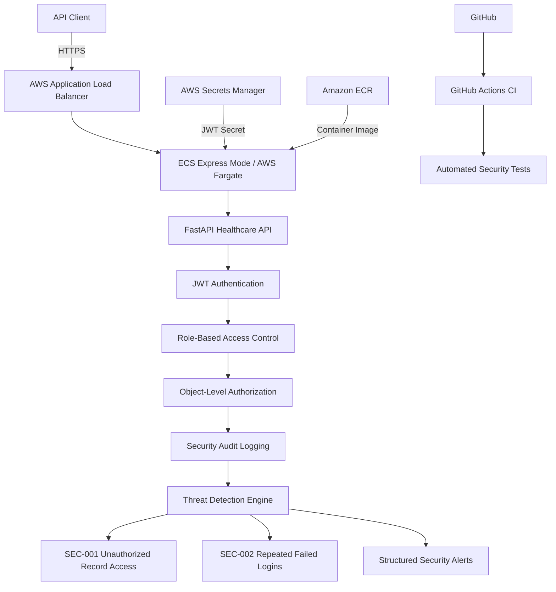

# Secure Healthcare Records API

[](https://github.com/forsonherbert19/secure-healthcare-api/actions/workflows/tests.yml)

A security-focused healthcare records API built with **Python, FastAPI, JWT authentication, RBAC, behavioral threat detection, Docker, GitHub Actions, and AWS**.

The project demonstrates how a healthcare-style API can protect sensitive records from unauthorized access while generating audit events and automated security alerts.

> **Note:** This project uses synthetic patient data only. It is an educational security portfolio project and is not represented as a production HIPAA-compliant system.

## Architecture



## Security Features

- JWT-based authentication with expiration, issuer, audience, `iat`, `nbf`, and unique `jti` claims
- Argon2 password hashing
- Timing-attack mitigation for invalid usernames
- Patient, doctor, and administrator roles
- Object-level authorization to reduce BOLA/IDOR risk
- Structured JSON audit logging
- Log injection sanitization
- Automated suspicious-access detection
- Repeated failed-login detection
- Security-alert cooldown to reduce duplicate alerts
- JWT signing secret stored in AWS Secrets Manager
- Private Amazon ECR container registry
- ECR image scanning on push
- Non-root Docker container
- GitHub Actions continuous integration
- Synthetic healthcare data only

## Detection Rules

| Rule | Severity | Detection |
|---|---|---|
| SEC-001 | HIGH | Three unauthorized patient-record access attempts within five minutes |
| SEC-002 | HIGH | Three failed login attempts for the same username within five minutes |

Example alert:

```json
{
  "rule_id": "SEC-001",
  "severity": "HIGH",
  "event": "RepeatedUnauthorizedRecordAccess",
  "username": "patient.alex",
  "failed_attempts": 3,
  "patient_ids": [102]
}
```

## Authorization Model

### Patient

A patient can access only the patient record mapped to their account.

### Doctor

A doctor can access records assigned to that doctor's user ID.

### Administrator

The demo administrator can access all synthetic records.

In a production healthcare environment, administrative clinical-data access would normally be further restricted according to least-privilege requirements.

## API Endpoints

| Endpoint | Method | Purpose |
|---|---|---|
| `/` | GET | Service information |
| `/health` | GET | Health check |
| `/auth/login` | POST | Authenticate and obtain JWT |
| `/users/me` | GET | Current authenticated user |
| `/patients` | GET | Authorized patient-record listing |
| `/patients/{patient_id}` | GET | Protected patient-record retrieval |

Interactive FastAPI documentation is available at:

```text
/docs
```

## Automated Tests

The project currently includes automated tests for:

- API health
- successful authentication
- rejected authentication
- authentication requirements
- patient self-access
- blocked cross-patient access
- doctor authorization
- administrator authorization
- SEC-001 detection
- SEC-002 detection

GitHub Actions automatically runs the test suite on pushes and pull requests to `main`.

## Cloud Deployment

The application is containerized and deployed using:

- Amazon ECS Express Mode
- AWS Fargate
- Application Load Balancer
- HTTPS/TLS
- Amazon ECR
- AWS Secrets Manager
- CloudWatch integration
- ECS autoscaling
- ARM64 container architecture

The application runs as a non-root container user:

```text
appuser
```

## Local Development

Create and activate a virtual environment:

```bash
python -m venv .venv
source .venv/bin/activate
```

Install dependencies:

```bash
pip install -r requirements.txt
```

Create a `.env` file:

```text
JWT_SECRET_KEY=<strong-random-secret>
```

Start the API:

```bash
uvicorn app.main:app --reload
```

Run tests:

```bash
pytest -v
```

## Docker

Build:

```bash
docker build -t secure-healthcare-api:1.0 .
```

Run:

```bash
docker run --rm \
  --env-file .env \
  -p 8000:8000 \
  secure-healthcare-api:1.0
```

## Technology Stack

**Application**
- Python
- FastAPI
- Pydantic
- PyJWT
- pwdlib / Argon2

**Security**
- JWT authentication
- RBAC
- Object-level authorization
- Audit logging
- Behavioral detection rules
- AWS Secrets Manager

**DevSecOps**
- pytest
- GitHub Actions
- Docker
- Amazon ECR vulnerability scanning

**Cloud**
- AWS ECS Express Mode
- AWS Fargate
- Elastic Load Balancing
- Amazon ECR
- AWS Secrets Manager
- CloudWatch

## Threat Model

See [`threat_model.md`](threat_model.md) for the project's threat model, trust boundaries, identified risks, controls, assumptions, and limitations.

## Disclaimer

All healthcare records, users, diagnoses, medications, and events in this repository are synthetic and created solely for educational and security-testing purposes.
